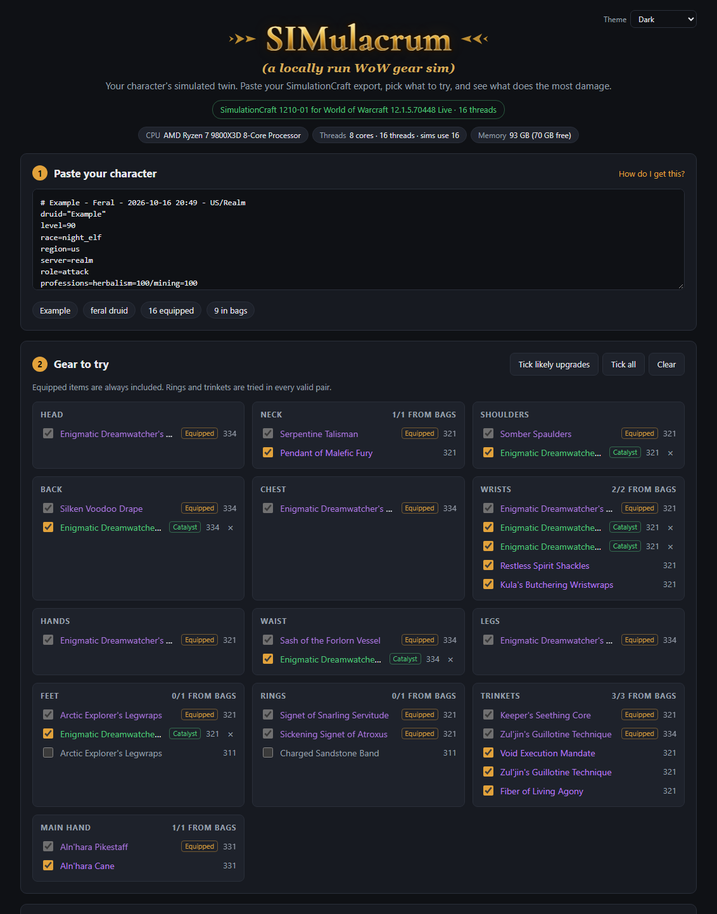
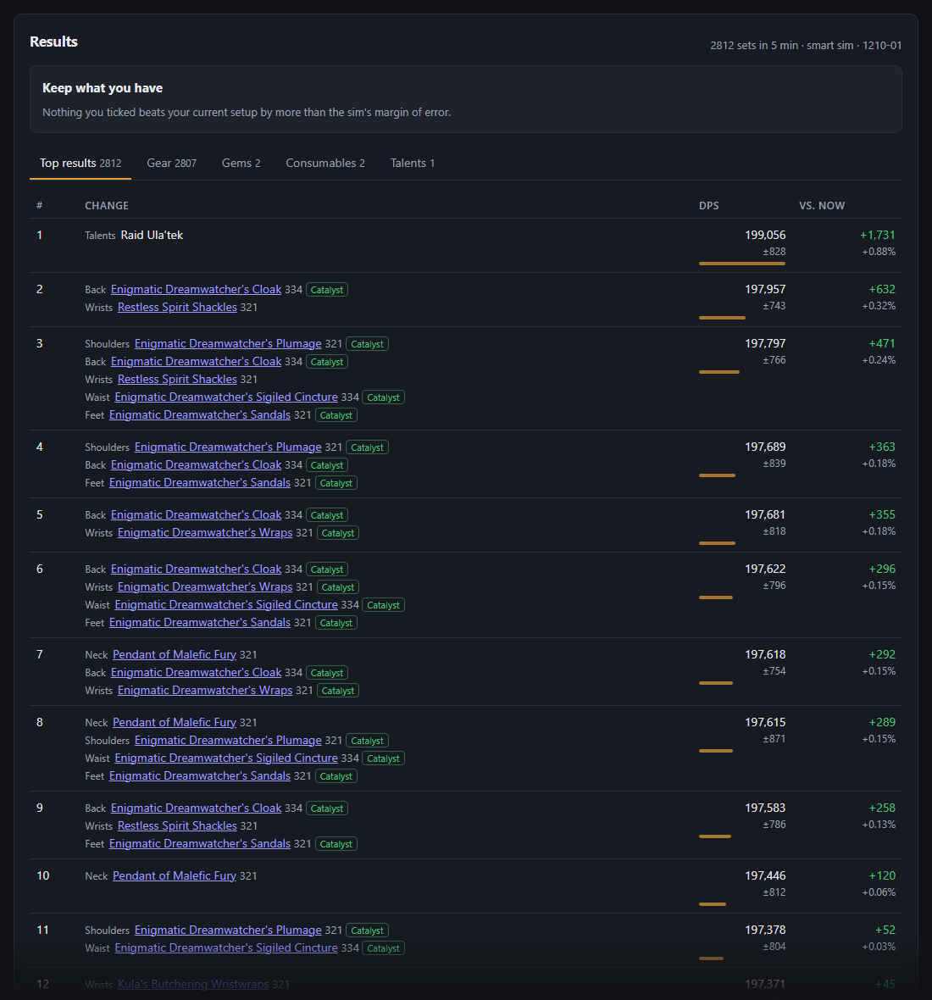
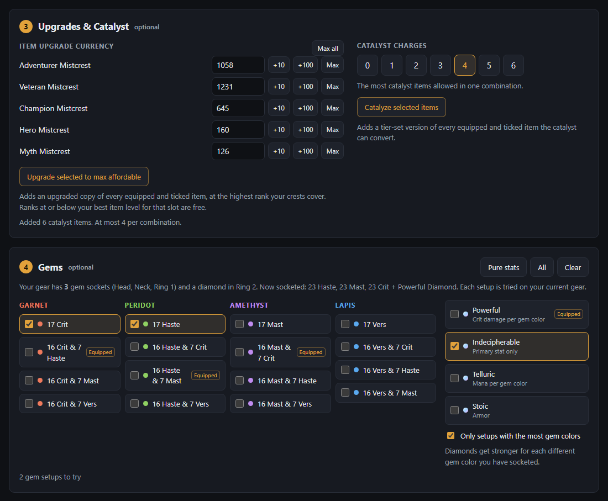
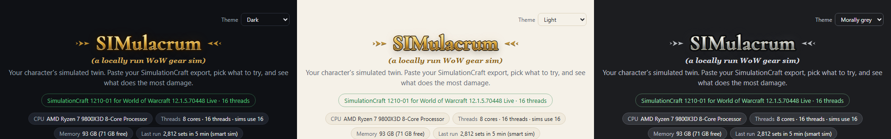

# SIMulacrum

A local "Top Gear" for World of Warcraft. Paste your SimulationCraft addon export and it sims your gear, gems, consumables and talent loadouts with [SimulationCraft](https://github.com/simulationcraft/simc), then ranks them by DPS.

It works for any class and spec. Everything comes from your export, and runs entirely on your PC with no limits.



## Features

- **Gear:** every valid combination of equipped and bag items. Rings and trinkets are tried in both slots, and unique items are never doubled.
- **Upgrades & catalyst:** add upgraded or catalyzed copies of your items. Your crests and catalyst charges come from the export, free ranks below your slot's best item level are counted, and combinations you can't afford are skipped.
- **Gems:** every way to fill your sockets with the gems you tick, plus diamond swaps.
- **Consumables:** food, flask, potion, weapon oil and augment rune.
- **Talents:** your saved loadouts from the export.
- **Smart sim:** a quick pass over everything, then re-sims the top results and anything statistically tied with them at full precision.
- **Results:** a recommended combination and a profile you can copy to double-check on Raidbots.
- **System info:** your CPU, threads, memory and last run speed. Very large runs ask before starting.

## Screenshots

**Results:** every set ranked against what you have on now, with the margin of error. The top card sums up the changes worth making.



**Upgrades, catalyst and gems:** your crests and catalyst charges come straight from the export.



**Themes:** dark, light and morally grey.



## OPTION 1: Download (Windows)

The easiest way: nothing to install.

1. Download **SIMulacrum-windows.zip** from the [latest release](https://github.com/ktmsft/wow-gear-sim/releases/latest).
2. Extract it, open the `SIMulacrum` folder and double-click **SIMulacrum.exe**. Your browser opens to the app.
3. If Windows says "Windows protected your PC", click **More info**, then **Run anyway**. The app isn't code-signed, so Windows doesn't recognize it.

The page shows how to copy your character from the game. After a WoW patch, click **Check for updates** at the bottom of the page to get the latest sim engine.

## OPTION 2: Running from source (Windows)

For developers, or if you want to build the sim engine yourself.

1. Install the tools (one time):

   ```powershell
   winget install OpenJS.NodeJS.LTS Git.Git Kitware.CMake
   winget install Microsoft.VisualStudio.2022.BuildTools --override "--quiet --wait --add Microsoft.VisualStudio.Workload.VCTools --includeRecommended"
   ```

2. Get the project and build the sim engine. The first build takes 10 to 20 minutes.

   ```powershell
   git clone https://github.com/ktmsft/wow-gear-sim
   cd wow-gear-sim
   powershell -ExecutionPolicy Bypass -File scripts\build-simc.ps1
   ```

3. Add a desktop shortcut:

   ```powershell
   powershell -ExecutionPolicy Bypass -File scripts\install-shortcut.ps1
   ```

   Double-click **SIMulacrum** to start it and open the page. Or run `npm start` and go to http://127.0.0.1:8787.

On macOS or Linux, build simc with CMake (`cmake -S simc-src -B build -DBUILD_GUI=OFF && cmake --build build --target simc`). Then either copy the binary to `simc/simc` or set `SIMC_PATH`, and run `npm start`.

## Simming your character

1. Install the **SimulationCraft** addon from [CurseForge](https://www.curseforge.com/wow/addons/simulationcraft) or Wago.
2. In game, type `/simc` and copy all the text in the window that opens. Include the bag items: those are what the tool compares.
3. Paste it into the page. It reads your class, spec, talents, gear and saved loadouts.
4. Tick the bag items, gems, consumables and loadouts you want to try, then pick a fight style and click **Run sim**.

"SimC default for your spec" uses SimulationCraft's recommended consumables for your class and spec.

## Keeping it current

After a WoW patch or hotfix, rerun `scripts\build-simc.ps1`. The page shows this command, with a copy button, under **Updating SimulationCraft**. No restart is needed.

The gem and consumable lists are in `lib/catalog.js`, for Midnight (patch 12.1). Update them when a new season adds items.

Upgrade tracks, crest costs and catalyst items are in `lib/season.js`. When a new season starts, regenerate it with `node scripts/update-season-data.mjs`, which reads Raidbots' public game data.

## Releases

The [Release workflow](.github/workflows/release.yml) builds SimulationCraft and `SIMulacrum.exe` on GitHub every Wednesday, publishing only when something changed. It can also be run by hand from the Actions tab. To package locally, run `npm install`, then `npm run package -- --simc simc\simc.exe`.

The logo uses [Cormorant](https://fonts.google.com/specimen/Cormorant) by the Cormorant Project Authors, under the SIL Open Font License (`public/fonts/OFL.txt`).

`simc.exe` is [SimulationCraft](https://github.com/simulationcraft/simc), licensed under GPL-3.0. Its license and source link ship in the zip's `licenses` folder.

## Settings

| Variable | Default | |
|---|---|---|
| `PORT` | `8787` | |
| `HOST` | `127.0.0.1` | Use `0.0.0.0` to allow other devices on your network |
| `SIMC_PATH` | `simc/simc.exe` | |
| `SIM_THREADS` | all cores | |

## Tests

```powershell
npm test
```

## Support

If SIMulacrum helps you, you can [buy me a coffee](https://buymeacoffee.com/bitofmoss). I also make [WoW addons on CurseForge](https://www.curseforge.com/members/abitofmoss/projects).
